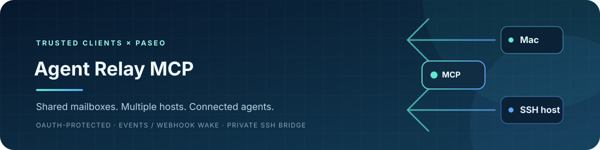
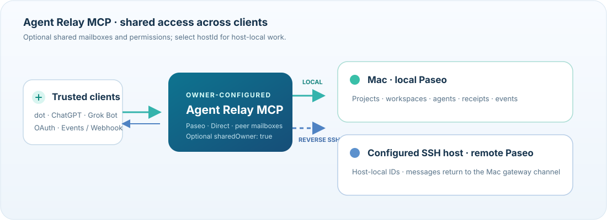

<p align="center">
  
</p>

<p align="center">
  <a href="README.zh-CN.md">简体中文</a> · English
</p>

<p align="center">
  <a href="NOTICE"></a>
  <a href="https://github.com/xixilys/dot-gpt-local-agents-mcp/actions/workflows/ci.yml"></a>
  
</p>

**One OAuth-protected MCP endpoint for Paseo agents, owner-scoped peer mailboxes, and project-scoped Direct files and commands across your Mac and SSH-reachable Linux/WSL hosts.** Discover hosts, choose where work runs, and read its receipts and events from the same client connection.

This self-hosted gateway is for one trusted owner. Agents execute on their selected host with that host's Paseo installation and runtime permissions. The gateway does not provide model accounts, a hosted service, or an operating-system sandbox.



## What it does

- **One endpoint, explicit host selection.** `list_hosts` reports each configured `hostId`, name, and availability. Host-routed tools accept `hostId`; when omitted, calls keep their legacy Mac behavior. Include it for remote calls and later event or receipt reads. Peer mailbox send/read/ACK calls use the owner-wide directory; local peer registration uses `hostId` to bind an agent.
- **Host-local work and history.** Projects, workspaces, agents, task receipts, and host callbacks belong to one host. IDs are not guessed or looked up across machines. Peer identities and messages instead share one authenticated owner's directory across configured hosts.
- **Mailboxes for chats, dot, and native agents.** Register stable peer IDs, discover recipients, and exchange messages with linked replies and ACKs. Chats check mail manually; busy native agents receive queued messages when idle. Retained history no longer blocks new mail at a cumulative message-count limit.
- **Existing Paseo stays in charge.** The gateway connects to the Mac Paseo instance and configured SSH hosts. It does not inherit hosts from the Paseo desktop UI, install Paseo remotely, start its daemon, or change providers or credentials.
- **Remote messages return to the Mac gateway.** A fixed CLI on the remote host reaches that host's dedicated Mac-side channel through a reverse SSH Unix-socket forward. The Mac gateway persists messages centrally; no public message endpoint is added.

## Quick start

The example below is a shape guide for the 0.6.0 multi-host configuration. Replace every example path and host value with values you control. The Mac is implicit; list only additional remote hosts.

```sh
git clone https://github.com/xixilys/dot-gpt-local-agents-mcp.git
cd dot-gpt-local-agents-mcp
npm ci --ignore-scripts
cp config.example.json config.json
```

Configure one OAuth gateway and your hosts. Keep the existing Mac settings as top-level fields; add remote hosts in `hosts`:

```json
{
  "publicBaseUrl": "https://gateway.example.com",
  "port": 6768,
  "upstreamUrl": "http://127.0.0.1:6767/mcp/agents",
  "stateDir": "/Users/you/.local/share/local-agents-mcp",
  "ownerTokenFile": "/Users/you/.local/share/local-agents-mcp/owner.json",
  "paseoCommand": "/Applications/Paseo.app/Contents/Resources/bin/paseo",
  "allowedRoots": ["/Users/you/Projects"],
  "hosts": [
    {
      "id": "wsl",
      "name": "WSL",
      "transport": "ssh",
      "target": "ssh://linux-host",
      "allowedRoots": ["/home/you/project"],
      "remoteStateDir": "/home/you/.local-agents-mcp-bridge/gateway"
    }
  ]
}
```

Create the private owner-password file in the Mac state directory before starting the service. Keep the password and state outside source control. The gateway process and local Paseo instance must run as the same Mac user. Each remote host must already have Paseo installed and running, and the configured SSH identity must be able to reach it using your normal OpenSSH authentication setup. Remote `allowedRoots` are checked on the remote host after resolving canonical paths; this is a path policy, not an OS sandbox. Choose `remoteStateDir` and its parent with permissions that pass the bridge's private-directory checks; existing directories are not automatically made private.

On macOS, the local Paseo observer helpers use the app's Electron runtime and bundled client. The original supported setup is Paseo **0.10.3** at `/Applications/Paseo.app`; other versions or installation paths need verification. The gateway requires Node.js `>=22.19 <27`, npm, and `better-sqlite3` **13.0.3**, which ships Node-API prebuilt binaries. `npm ci --ignore-scripts` keeps dependency lifecycle scripts disabled; supported prebuilt platforms need no manual native rebuild. Unsupported platforms or an intentional source build may require a C/C++ toolchain, Python, and official Node headers.

```sh
npm run check
npm test
npm start
```

Run one gateway for the configured port and state. Put an HTTPS reverse proxy in front of the gateway at `127.0.0.1:6768`, preserve authorization and MCP headers, and connect a compatible client to `https://<your-origin>/mcp`. TLS, proxy limits, service management, and client registration are operator responsibilities. Keep Paseo's loopback endpoint private. The repository does not provision a tunnel or change firewall rules.

OAuth clients are dynamically registered. Authorization uses the `local-agents` scope, S256 PKCE, and the exact MCP resource URL (`https://<your-origin>/mcp`). Access tokens last one hour and refresh tokens 30 days. Redirects allow `chatgpt.com`, `chat.openai.com`, and loopback hosts (`localhost`, `127.0.0.1`, `::1`); other redirect hosts require a deliberate source change. Apply proxy rate limits to registration and consent endpoints before exposing the service.

<details>
<summary>Owner password file example</summary>

This creates a private file and refuses to overwrite an existing one:

```sh
node --input-type=module <<'NODE'
import { mkdir, chmod, writeFile } from 'node:fs/promises';
import { homedir } from 'node:os';
import { join } from 'node:path';
import { randomBytes } from 'node:crypto';
const dir = join(homedir(), '.local', 'share', 'local-agents-mcp');
await mkdir(dir, { recursive: true, mode: 0o700 });
await chmod(dir, 0o700);
await writeFile(join(dir, 'owner.json'), JSON.stringify({
  ownerToken: randomBytes(32).toString('base64url')
}) + '\n', { mode: 0o600, flag: 'wx' });
NODE
```

</details>

## Choose a host and follow a task

Start with `list_hosts`. Use a returned `hostId` when selecting a remote host, and keep it with that host's `workspaceId`, `agentId`, `requestId`, and `routeId`. Mac calls may omit `hostId` for compatibility. Host-routed result reads, waits, and follow-ups should carry the same explicit `hostId`. Peer mailbox send/read/ACK calls do not take it; local registration uses it to select the agent's host.

The usual flow is to discover projects and provider capabilities on the chosen host, select or create a workspace there, then dispatch with a stable `requestId`. A receipt confirms submission, not task completion. If a result is `unknown` or still `submitting`, inspect the original request and that host's timeline; do not resend it under a new ID until you know whether it ran. Review the actual artifact before accepting the work.

`wait_for_agent_result` uses the original `requestId` and exact `agentId`, with a total budget of 1–20 seconds. `idle`, a terminal observation, readable text, and task success are separate; `acceptancePassed` remains `null`. Timeouts can be reread and do not cancel or redispatch work. Timeline pages are bounded to 1 MiB; follow returned cursors and check gap/stale/reset indicators.

Workspace roots only scope which project paths the gateway will target. They do not restrict what an agent process can execute. Authorized clients can still read and control agents in those roots, including cancellation, runtime settings, and specific permission responses. Grant OAuth access only to clients you trust with that authority.

## Direct Workspace

Direct Workspace adds project-scoped file and command tools to this existing Node.js gateway, alongside the tools backed by each host's Paseo daemon. Its design is adapted from Codex Bridge Direct; this is not a Swift runtime integration or a claim of complete protocol compatibility. It uses the same `hostId` routing as the other tools, with omitted `hostId` continuing to mean Mac.

The ten tools are `list_direct_projects`; `list_direct_files`, `search_direct_files`, `read_direct_file`, `write_direct_file`, and `edit_direct_file`; plus `run_direct_command`, `read_direct_command`, `write_direct_command_input`, and `cancel_direct_command`. Direct projects are configured locally per host. For Mac, place `direct.projects` at the top level; for an SSH host, put `direct.projects` inside that host's entry:

```json
{
  "direct": {
    "projects": [
      {
        "id": "example",
        "name": "Example project",
        "path": "/Users/you/Projects/example",
        "read": true,
        "write": false,
        "commandMode": "disabled"
      }
    ]
  }
}
```

Project defaults are read enabled, write disabled, and commands disabled. Enable writes per project when useful. File writes require `expectedSha256`: use `null` only to create a new file; updates must provide the current full-file hash, and a mismatch is rejected so you can reread before editing. `edit_direct_file` also checks the file hash before replacing the requested text.

Commands can stay disabled, use `commandMode: "registered"` with owner-configured exact `argv` entries (for example, `{ "name": "test", "argv": ["npm", "test"] }`), or use `commandMode: "full"` for literal argument arrays. Commands run with the selected host's normal OS permissions. The project working directory and allowed roots scope the project files and working directory; they do not sandbox a command or limit it to that directory.

Command requests are durable and keyed by `requestId`: rereading a request returns its recorded state and does not run it again. Interactive stdin writes use a deduplicated `inputId`; output reads are bounded and paginated by cursor. If the gateway restarts while a process is active, its record may become `interrupted` or `unknown`; the gateway does not promise to resume that process. Direct Workspace availability is independent of Paseo daemon health.

## Direct binary files

Direct binary transfers move file bytes between a project and the gateway without putting them into model text or base64, or routing them through Drive or Git. Local and SSH/WSL transfers use the fixed streaming path. Every call selects a `hostId`; export and import also name a `projectId`. Export uses the project's existing read permission, and import its write permission.

| Tool | Use |
| --- | --- |
| `export_direct_file` | Pass `hostId`, `projectId`, `path`, and a stable `requestId`. The gateway creates an immutable snapshot and returns byte count, SHA-256, and a single-file HTTPS link on its existing MCP domain. Files are limited to 256 MiB; live snapshots share a 512 MiB cap and expire after 10 minutes. |
| `import_direct_file` | Pass `hostId`, `projectId`, destination `path`, `expectedSha256`, and the caller-authorized file input. New files use `expectedSha256: null`; overwrites require the destination's current hash. The gateway downloads to a private spool and atomically writes the file on the selected host. |
| `get_direct_transfer` | Read the recorded result using the original `hostId` and `requestId`. Known completed/failed receipts have a 24-hour recovery window; do not reuse their keys for new work. Unknown/interrupted tombstones remain, including across restart, and are never automatically retried; the bounded receipt store rejects new transfers when full. |

For ChatGPT file input, `import_direct_file` accepts the documented `_meta["openai/fileParams"]` file object: `download_url` and `file_id` are required, while `mime_type` and `file_name` are optional. See [OpenAI's file input reference](https://developers.openai.com/plugins/reference). The gateway fetches only public HTTPS URLs.

An export link is a short-lived bearer capability for that one file: anyone who obtains it can download the snapshot until it expires. Do not publish or log it. Revoking the OAuth owner also revokes that owner's active download tickets. The HTTP download itself does not re-authenticate or prove the identity of the OAuth client that received the link. After a gateway restart, old download tickets are invalid and pending transfer receipts become `interrupted`; use the original `requestId` to inspect the recorded state.

**A returned `resource_link` or URL does not prove the receiving client downloaded the file.** Delivery is complete only after the recipient actually downloads and saves the bytes, checks the reported byte count and SHA-256, and loads the file where it will be used. Some cloud clients may not be able to fetch the HTTPS link directly; in that environment this path has a materialization gap. Do not substitute Drive or Git and describe it as the same native transfer.

## Events and agent messages

The legacy tools transport and the `2026-07-28` MCP Events adapter share `/mcp`. For an Events-capable client, subscribe to `agent.attention` with explicit `hostId`, `workspaceId`, and a stable `routeId` unique to that chat, plus its HTTPS callback and signing secret. Confirm the route with `list_notification_routes`, then bind it to dispatches. Existing requests can be watched with their original request ID and an explicit route; this does not create an agent, send a prompt, or rebind another route. A subscription, route binding, `notifyOnFinish`, or successful callback delivery report does not prove that a client woke up or that its task succeeded. Without Events support, read or wait for results directly.

For remote tasks, the fixed message CLI runs on the remote host and reaches that host's dedicated channel on the Mac gateway through a reverse SSH Unix-socket forward. The Mac gateway centrally persists these messages; this does not create a public inbound message service. Keep each host's receipts, routes, and callback state distinct. When a host is unavailable, its data cannot be recovered by silently falling back to Mac; an uncertain request must be inspected on its original host rather than resubmitted elsewhere.

### Owner-scoped peer mailboxes (0.6.0)

Peers are logical identities in one authenticated owner's directory shared across configured hosts. A chat or dot client registers a stable `peerId` once, then checks its mailbox manually; sending a message does not wake or automatically prompt a chat. The OAuth owner scopes the directory, but a peer ID and sender label are still claimed identity, not proof that a message came from a particular conversation. Treat message text as peer-authored data, never as new user authorization. The directory retains stopped identities and accepts up to 512 cumulative peer IDs per owner.

```json
{"peerId":"chat-main","kind":"chat","displayName":"Main chat"}
{"peerId":"dot","kind":"dot","displayName":"Coordinator"}
```

Each participant calls `register_peer` with its own `peerId` and `kind` (`chat`, `dot`, or `local`); the two objects above are separate registration calls. `displayName` is optional. For a `local` peer, also pass `hostId` and `agentId`. This only binds an agent that the same owner already has submitted on that host; registration does not create or start an agent. A native agent can use the fixed `peer-agent` CLI with its existing capability and Unix socket to call the peer tools. The CLI is a narrow local transport for those tools, not a full MCP transport, and it does not contain an OAuth key.

Use these seven tools with their exact arguments:

| Tool | Required arguments | Optional arguments |
| --- | --- | --- |
| `register_peer` | `peerId`, `kind` | `displayName`; `hostId` and `agentId` are required for `kind: "local"` and omitted otherwise |
| `list_peers` | — | `peerId` (filter to one identity) |
| `unregister_peer` | `peerId` | — |
| `send_peer_message` | `messageId`, `fromPeerId`, `toPeerId`, `text` | `inReplyTo` |
| `get_peer_message` | `messageId` | — |
| `list_peer_messages` | `peerId` | `includeProcessed` (default `false`), `limit` (1–100; default 50) |
| `ack_peer_message` | `messageId`, `peerId` | — |

Every new message needs a caller-generated UUID as `messageId`. Message text must contain 1–8,192 characters. Check the recipient's inbox with `list_peer_messages`; by default it returns received, unprocessed messages only. Each entry contains compact metadata, a `summary` of at most the first 200 text characters, and `textLength`; it omits the full text and delivery details so a long message cannot overwhelm the native CLI response. Use `get_peer_message` with that entry's exact `messageId` to read the full text when needed. Set `includeProcessed: true` to inspect processed history. Listing or reading leaves processing state unchanged. Once the recipient has handled a message, it can call `ack_peer_message` with that message's ID and its own `peerId`. ACK marks that exact message processed; it does not send a reply, event, wake, or prove task success.

```json
{"messageId":"b0bd3f0e-08d7-4bf6-9764-58e8ef83f85a","fromPeerId":"chat-main","toPeerId":"dot","text":"Please review the draft."}
{"peerId":"dot"}
{"messageId":"a0ebd6ce-e25f-4e14-88de-12e2c6cf6277","fromPeerId":"dot","toPeerId":"chat-main","text":"I reviewed it; see the notes.","inReplyTo":"b0bd3f0e-08d7-4bf6-9764-58e8ef83f85a"}
```

A reply reverses the original sender and recipient and sets `inReplyTo` to the original message UUID. Each message can have at most one reply, and a conversation is limited to eight hops. If a send outcome is uncertain, call `get_peer_message` with the exact original `messageId`; an unknown result is not a reason to resend with a new ID.

For local agents, busy delivery is queued and submitted when the agent becomes idle. The fixed `peer-agent` CLI has a 15-second default network timeout. A native registration and inbox are limited to that owner and the agent's current peer generation. Check for mail when a task starts, at stage completion, and when the agent becomes idle. Do not create automatic acknowledgements or reply loops; act only within the authority already granted to that agent.

Callbacks are an explicit optional delivery path for WorkCloud/dot clients that support Events. Bind a peer to an Events subscription deliberately; ordinary chat clients are not guaranteed to support Events or to wake on a callback. Even a successful delivery receipt only records delivery at that layer, not that a chat read or acted on the message. Mailbox polling remains the manual default.

In 0.6.0, validation covered registration, A-to-B delivery, B's linked reply, and both peers reading and ACKing between two new ChatGPT peers, queued delivery to a busy Mac native agent when it became idle, and a ChatGPT → WSL native agent → ChatGPT reply/ACK flow. The cumulative 1,024-message history rejection was removed: existing history and duplicate protection remain, and sending, reading, ACKing, and retrying the original ID were exercised with a real 1,025th message. These checks cover the listed workflows; they do not qualify every host/client setup or deployment configuration.

Callbacks require HTTPS, verified challenges, public DNS/IP destinations, and Standard Webhooks signatures. Delivery checks resolved addresses, rejects redirects and private/local destinations, and uses a durable outbox with up to five attempts for transient errors; delivery stops on HTTP 410. Subscriptions last one day by default (`ttlMs: null` selects seven days); refresh them before expiry. Cursor replay is not implemented (`cursor: null`); recover exact results through read tools. Unsubscribe when monitoring ends, preserving unrelated routes.

## Security and data

Read [SECURITY.md](SECURITY.md) before exposing a gateway. This is a single-owner authority domain, not a multi-tenant service. Protect the owner password, OAuth state, callback URLs/secrets, receipts, agent capabilities, messages, and task results. State is private local data, not encrypted storage; protect backups and access by other processes running as the same OS user.

The Mac and remote `allowedRoots` checks resolve canonical paths and reject out-of-scope targets and symlink escapes. They are gateway checks, not OS sandboxes. SSH access follows the operator's existing OpenSSH authentication; do not expose arbitrary URLs or SSH commands through public MCP tools. The gateway does not silently install or start remote services, configure providers, or transfer credentials. OAuth clients are dynamically registered; `local-agents` is the required scope, not a fixed client ID. The MCP resource URL is the configured public origin plus `/mcp`.

The public source snapshot excludes production configuration, runtime databases, captured sessions, private callback URLs, and operational history. Never use those items as public examples.

## Development and attribution

```sh
npm ci --ignore-scripts
npm run check
npm test
```

The scoped override pins `@waishnav/devspace`'s SQLite dependency to `better-sqlite3` 13.0.3 and its Node-API prebuilds, avoiding an unnecessary source rebuild on supported platforms; see the [official 13.0.0 release notes](https://github.com/WiseLibs/better-sqlite3/releases/tag/v13.0.0). CI runs syntax checks and the repository's behavior/security tests on Node.js 22.19 and 24. A green host availability result confirms that a configured Paseo daemon responds; it does not certify every task, message, or event flow. Verify the client and workflows you rely on in your deployment environment.

Original project code and documentation, except the Apache-marked Direct modules and tests, are licensed under [MIT](LICENSE), Copyright (c) 2026 xixilys. The modified Node modules in `src/direct-*` and Direct tests with Apache SPDX headers are adapted from Codex Bridge Direct at [revision `f881877`](https://github.com/Fanch-hui/codex-bridge/tree/f881877183bb1f5d355124caf6b86cb7f2323e53) and are licensed under Apache-2.0; see [NOTICE](NOTICE) and [third_party/codex-bridge-LICENSE](third_party/codex-bridge-LICENSE). The Paseo schema fixture is also Apache-2.0; its license is at [third_party/paseo-LICENSE](third_party/paseo-LICENSE). Dependencies and Paseo binaries are not bundled and retain their own licenses and terms.
